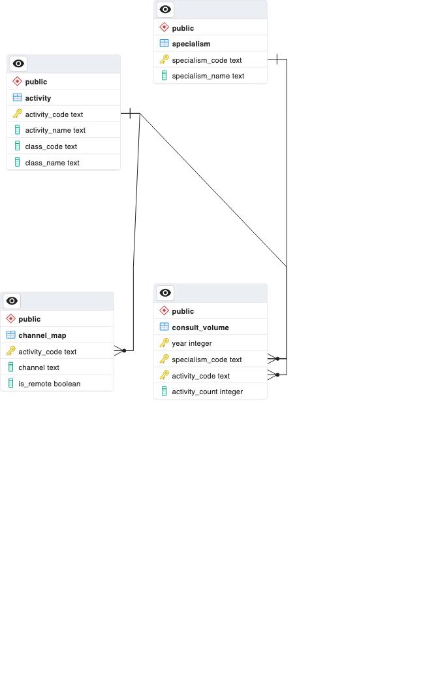

# Remote Care Opportunity: where Dutch hospital consults are moving remote (2019 to 2024)

> Fictional stakeholder brief; the data is real and public (NZa Open DIS data, CC0).

**Status:** definition and database done. Queries and findings follow. The title will
carry the answer once the analysis is finished.

## The brief

- **Stakeholder:** the product and market team of a Dutch health-tech company that builds and
  sells video consultation and telemonitoring software to hospitals and independent
  treatment centres (ZBCs). The company and the request are fictional; the data is real.
- **Decision:** which 3 medical specialisms to target first in the 2027 product roadmap and
  sales plan.
- **What they can change:**
  - which features to build first (phone and video consults, written consults, or home
    monitoring);
  - which hospital departments the sales team approaches;
  - the marketing message per specialism.
- **What they already believe (to confirm or challenge):**
  - video consults are the main and fastest-growing form of remote care;
  - the specialisms that already use the most remote care are the best targets.

**Business context.** Dutch hospitals bill care per treatment path (DBC), and every consult,
scan or operation in that path is registered as an activity. Since 2018 hospitals can
register a consult by phone, video or in writing as a replacement for a clinic visit, and
telemonitoring has its own code. The Dutch government wants more digital and hybrid care
(the IZA and AZWA health agreements), so hospitals are under pressure to move suitable
visits out of the clinic. For a company selling remote-care software, the national
registration data shows where remote care is already used, where it is growing, and where
it is still rare.

## Business question

**Which 3 specialisms offer the biggest opportunity for remote-care software in 2027, based
on how many outpatient consults they have, what share is already remote, and how fast that
share grew from 2019 to 2024?**

1. **Size.** How many outpatient consults did each specialism have in 2019 and in 2024?
2. **Adoption.** What share of each specialism's consults was remote in 2019 and in 2024?
3. **Growth and durability.** How did that share change year by year from 2019 to 2024, and
   did it stay up after the 2020 jump?
4. **Channel.** Which forms (phone, video, written, telemonitoring) make up remote care, and
   which grew fastest?
5. **Decision.** Combining size, share and growth, which 3 specialisms rank highest as
   targets, and what kind of opportunity is each?

**Hypotheses (written before any analysis):**

- **Main (H3).** The best targets are not the specialisms with the highest remote share.
  They are large specialisms with a medium remote share that is still growing.
- **Supporting (H2).** The remote share jumped in 2020 and stayed well above 2019 in most
  specialisms.

**Out of scope:** whether remote care is better, safer or cheaper than a clinic visit;
individual hospitals (not in the data); patient experience; 2025 and 2026 (still
incomplete); inpatient care.

## Metric definitions

**Ground rules for every KPI:**

- **Follow-up (repeat) consults only.** In 2019 a remote *first* visit had no code yet, so
  only follow-up consults compare fairly between 2019 and 2024.
- **Count activities, never patients.** The count is `AANTAL_ZAT` (number of activities),
  which can be summed across rows. Patient counts cannot, because one patient appears in
  several treatment paths.
- **National figures are pooled, never averaged.** A national share is total remote divided
  by total consults, not the average of the specialisms' shares.
- **Remote means phone, video and written.** Telemonitoring is not a consult (it is a
  monitoring period), so it stays out of the share and is reported separately.

| KPI | Formula | Unit | Benchmark |
|---|---|---|---|
| 1. Consult volume | follow-up consults (clinic + remote) per specialism, 2024 (2019 for context) | consults | share of all follow-up consults nationally |
| 2. Remote share | remote follow-up consults / all follow-up consults, 2019 and 2024 | % | national remote share, same year |
| 3a. Share change | remote share 2024 minus 2019 | percentage points | national change |
| 3b. Momentum | remote share 2024 minus 2022 | percentage points | national change |
| 4. Channel mix | each channel's share of remote follow-up consults, 2019 vs 2024, plus volume growth shown next to absolute numbers | % | national mix |
| **5. Remote headroom (headline)** | clinic follow-up consults in 2024, only for specialisms with momentum above 0 and a 2024 remote share of at least 10% | consults | ranking: top 3 are the targets |

Share changes are in percentage points, not percent: going from 5% to 10% is +5 points but
+100%, and percent growth makes tiny starting shares look huge.

**Remote headroom** is the number of follow-up visits still done in the clinic that could
move to remote, counted only in specialisms where remote care already works (at least 1 in
10 follow-up visits is remote) and is still growing. It is a possible market, not a proven
one: the data does not say which visits are clinically suitable for remote care.

## Scope and data plan

- **Level of detail:** year × specialism × activity. Diagnoses and care products are summed
  away, because no KPI needs them.
- **Years:** every year from 2019 (pre-COVID baseline) to 2024 (last full year).
- **Fields:** `JAAR`, `BEHANDELEND_SPECIALISME_CD`, `ZORGACTIVITEIT_CD`, `AANTAL_ZAT` from
  `02_DBC_PROFIEL`; specialism names from `06_REF_SPC`; activity descriptions from
  `03_REF_ZAT`.
- **Join keys:** specialism code and activity code, both stored as text (they have leading
  zeros).

**Activity code to channel mapping (follow-up visits only):**

| Channel | Code | Description (NZa) | Years |
|---|---|---|---|
| Clinic | `190013` | Herhaal-polikliniekbezoek | all |
| Phone | `190162` | Belconsult ter vervanging van een herhaal-polikliniekbezoek | from 2018 |
| Written | `190163` | Schriftelijke consultatie ter vervanging van een herhaal-polikliniekbezoek | from 2018 |
| Video | `190161` | Screen to screen consult ter vervanging van een polikliniekbezoek | 2018 to 2020 |
| Video | `190166` | Screen-to-screen consult ter vervanging van een herhaal-polikliniekbezoek | from 2021 |
| Telemonitoring (separate) | `039133` | Telemonitoring | |

The video code used up to 2020 (`190161`) does not say whether it replaced a first or a
follow-up visit. All of it is counted as follow-up video. Video is small and most visits are
follow-ups, so the error is small.

**Fallback:** if loading all 10.8 million activity rows is too slow, load only the rows for
the codes above. If time runs short, drop KPI 4 (channel mix); KPIs 1, 2, 3 and 5 still
answer the main question.

## Database

PostgreSQL database `remote_care`, four tables:



- **`specialism`** (701 rows) and **`activity`** (4,074 rows): lookup tables from the NZa
  reference files.
- **`channel_map`** (6 rows): the activity code to channel mapping above, typed by hand, so
  the business rule lives in one table instead of in every query.
- **`consult_volume`** (185,440 rows): the number of activities per year, specialism and
  activity, summed from the 10,865,746 rows of `02_DBC_PROFIEL`. Primary key: year +
  specialism + activity.

Every code is stored as text, because codes have leading zeros (`0303`, `039133`).

**How the data is loaded.** Each CSV first goes into a staging table, an exact copy with
every column as text. SQL then picks, renames, converts and sums the columns into the four
tables above. **12,030 rows were dropped**: their activity code (`039679`, `039813`,
`039814`) is missing from the NZa activity reference table. None of the three is a consult
code, so no KPI is affected.

**Build the database** (from the project folder, with the CSVs in `data/raw/`):

```bash
createdb remote_care
psql -d remote_care -f sql/01_schema.sql
psql -d remote_care -f sql/02_load.sql
```

**Validate the load.** `sql/03_validate.sql` runs seven checks, each with its expected
number written in the comment above it before it was run. All seven pass:

1. Row counts of the four tables: 701, 4,074, 6 and 185,440.
2. Grand total of activities equals the load checksum: 1,186,779,701.
3. One line per year, 2012 to 2026; only 2026 is far smaller (still being filled in).
4. 28 specialisms appear in the data.
5. The six mapped codes carry the expected NZa names and classes, and video has no gap
   (old code 2018 to 2020, new code from 2021).
6. No fan-out: joining `channel_map` leaves the 2019 to 2024 total unchanged (114,525,564).
7. One cell (2024, ophthalmology, phone) is the same in the raw staging table and the final
   table: 118,888.

```bash
psql -P pager=off -d remote_care -f sql/03_validate.sql
```

## Data source

- [Open DIS data, NZa](https://opendisdata.nza.nl/), public domain (CC0).
- File description (Dutch, PDF): [DIS00981 Beschrijving downloads Open DIS data 1.0](https://opendisdata.nza.nl/downloads/DIS00981_Beschrijving_downloads_Open_DIS_data_1.0.pdf).
- Files used (download into `data/raw/`, they are not in this repo):
  - [02_DBC_PROFIEL.csv](https://opendisdata.nza.nl/download/csv/02_DBC_PROFIEL.csv), care activities, about 757 MB
  - [06_REF_SPC.csv](https://opendisdata.nza.nl/download/csv/06_REF_SPC.csv), specialisms
  - [03_REF_ZAT.csv](https://opendisdata.nza.nl/download/csv/03_REF_ZAT.csv), care activities reference

## Project structure

```
sql/          schema, load and analysis scripts, numbered in run order
notebooks/    Python step: query the database into pandas, charts
data/raw/     the downloaded CSVs (gitignored)
docs/         the schema diagram
```
