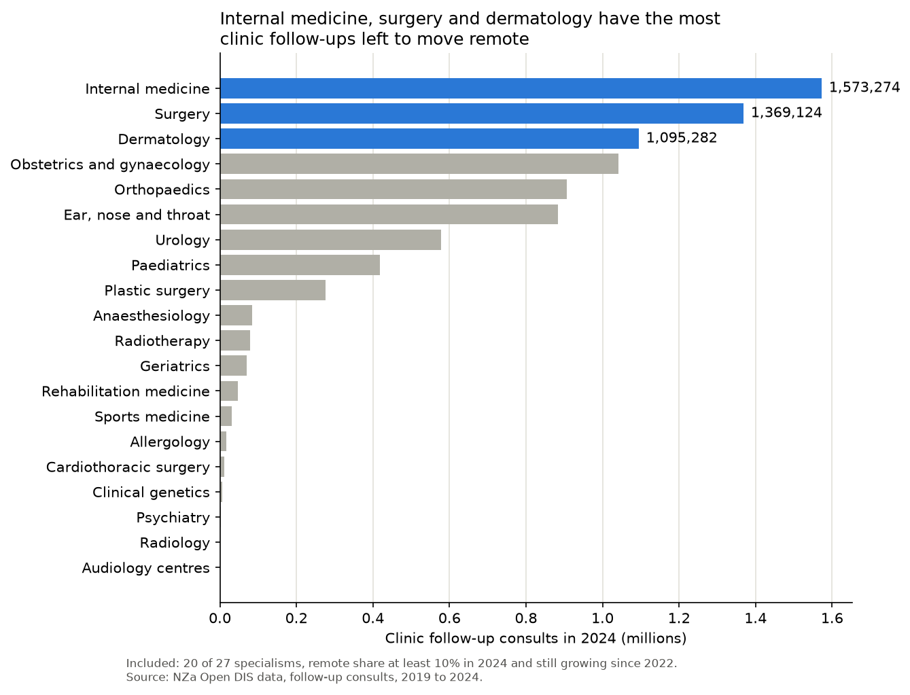
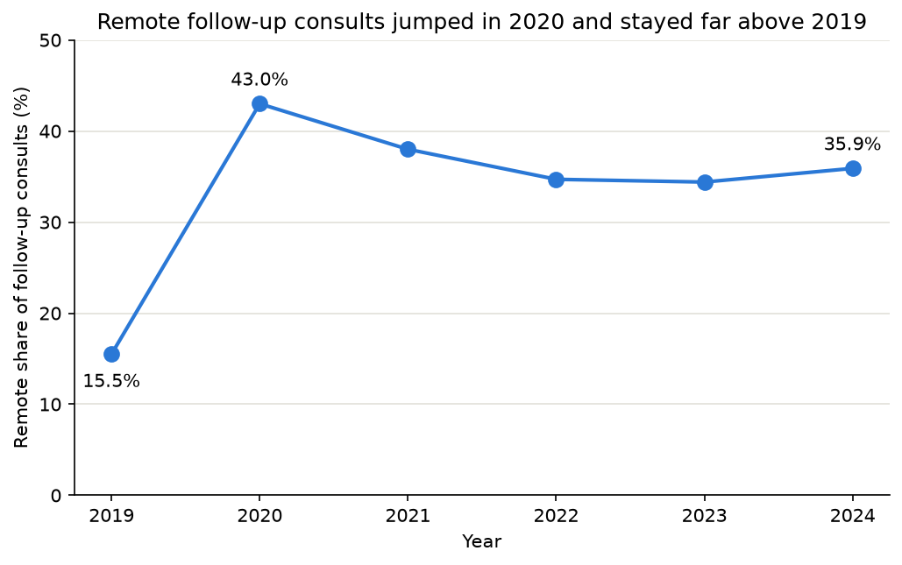

# Remote Care Opportunity: target internal medicine, surgery and dermatology

Where Dutch hospital follow-up consults are moving remote, 2019 to 2024. A SQL and Python
analysis of national hospital registration data.

> Fictional stakeholder brief; the data is real and public (NZa Open DIS data, CC0).

## The answer

**Target internal medicine, surgery and dermatology.** In 2024 these three specialisms still
had 4,037,680 follow-up consults in the clinic (almost a third of all clinic follow-ups in the
country), and in all three remote care already works and is still growing.



- **Remote care is here to stay.** The remote share of hospital follow-up consults jumped from
  15.5% (2019) to 43.0% (2020) and settled at 35.9% in 2024, more than double the pre-COVID
  level. All 26 specialisms with 2019 data stayed above their 2019 share.
- **It is a phone market, not a video market.** 98.0% of remote follow-up consults in 2024 were
  phone calls. Video was 0.9%, even after growing almost tenfold since 2019.
- **The most remote specialisms are not the biggest opportunity.** Clinical genetics, radiology
  and anaesthesiology have the highest remote shares, but they are small and have little left
  to move. The opportunity is in large specialisms with a medium share that is still growing.
- **The answer is robust.** The same top 3 comes out with a 10% or a 15% floor for "remote care
  proven"; only a 5% floor swaps dermatology for ophthalmology.

**Skills shown:** relational schema design in PostgreSQL (composite and foreign keys, staging
loads), validation checks with expected numbers written first, layered SQL views, CTEs and
window functions (`LAG`, `RANK`, `ROW_NUMBER`, `SUM() OVER`), and Python (`pandas.read_sql`,
matplotlib) on top of SQL.

## The brief

- **Stakeholder:** the product and market team of a Dutch health-tech company that builds and
  sells video consultation and telemonitoring software to hospitals and independent
  treatment centres (ZBCs). The company and the request are fictional; the data is real.
- **Decision:** which 3 medical specialisms to target first in the 2027 product roadmap and
  sales plan.
- **What they can change:**
  - which features to build first (phone and video consults, written consults, or home
    monitoring);
  - which hospital departments the sales team approaches;
  - the marketing message per specialism.
- **What they already believe (to confirm or challenge):**
  - video consults are the main and fastest-growing form of remote care;
  - the specialisms that already use the most remote care are the best targets.

**Business context.** Dutch hospitals bill care per treatment path (DBC), and every consult,
scan or operation in that path is registered as an activity. Since 2018 hospitals can
register a consult by phone, video or in writing as a replacement for a clinic visit, and
telemonitoring has its own code. The Dutch government wants more digital and hybrid care
(the IZA and AZWA health agreements), so hospitals are under pressure to move suitable
visits out of the clinic. For a company selling remote-care software, the national
registration data shows where remote care is already used, where it is growing, and where
it is still rare.

## Business question

**Which 3 specialisms offer the biggest opportunity for remote-care software in 2027, based
on how many outpatient consults they have, what share is already remote, and how fast that
share grew from 2019 to 2024?**

1. **Size.** How many outpatient consults did each specialism have in 2019 and in 2024?
2. **Adoption.** What share of each specialism's consults was remote in 2019 and in 2024?
3. **Growth and durability.** How did that share change year by year from 2019 to 2024, and
   did it stay up after the 2020 jump?
4. **Channel.** Which forms (phone, video, written, telemonitoring) make up remote care, and
   which grew fastest?
5. **Decision.** Combining size, share and growth, which 3 specialisms rank highest as
   targets, and what kind of opportunity is each?

**Hypotheses (written before any analysis):**

- **Main (H3).** The best targets are not the specialisms with the highest remote share.
  They are large specialisms with a medium remote share that is still growing.
- **Supporting (H2).** The remote share jumped in 2020 and stayed well above 2019 in most
  specialisms.

**Out of scope:** whether remote care is better, safer or cheaper than a clinic visit;
individual hospitals (not in the data); patient experience; 2025 and 2026 (still
incomplete); inpatient care.

## Metric definitions

**Ground rules for every KPI:**

- **Follow-up (repeat) consults only.** In 2019 a remote *first* visit had no code yet, so
  only follow-up consults compare fairly between 2019 and 2024.
- **Count activities, never patients.** The count is `AANTAL_ZAT` (number of activities),
  which can be summed across rows. Patient counts cannot, because one patient appears in
  several treatment paths.
- **National figures are pooled, never averaged.** A national share is total remote divided
  by total consults, not the average of the specialisms' shares.
- **Remote means phone, video and written.** Telemonitoring is not a consult (it is a
  monitoring period), so it stays out of the share and is reported separately.

| KPI | Formula | Unit | Benchmark |
|---|---|---|---|
| 1. Consult volume | follow-up consults (clinic + remote) per specialism, 2024 (2019 for context) | consults | share of all follow-up consults nationally |
| 2. Remote share | remote follow-up consults / all follow-up consults, 2019 and 2024 | % | national remote share, same year |
| 3a. Share change | remote share 2024 minus 2019 | percentage points | national change |
| 3b. Momentum | remote share 2024 minus 2022 | percentage points | national change |
| 4. Channel mix | each channel's share of remote follow-up consults, 2019 vs 2024, plus volume growth shown next to absolute numbers | % | national mix |
| **5. Remote headroom (headline)** | clinic follow-up consults in 2024, only for specialisms with momentum above 0 and a 2024 remote share of at least 10% | consults | ranking: top 3 are the targets |

Share changes are in percentage points, not percent: going from 5% to 10% is +5 points but
+100%, and percent growth makes tiny starting shares look huge.

**Remote headroom** is the number of follow-up visits still done in the clinic that could
move to remote, counted only in specialisms where remote care already works (at least 1 in
10 follow-up visits is remote) and is still growing. It is a possible market, not a proven
one: the data does not say which visits are clinically suitable for remote care.

## Scope and data plan

- **Level of detail:** year × specialism × activity. Diagnoses and care products are summed
  away, because no KPI needs them.
- **Years:** every year from 2019 (pre-COVID baseline) to 2024 (last full year).
- **Fields:** `JAAR`, `BEHANDELEND_SPECIALISME_CD`, `ZORGACTIVITEIT_CD`, `AANTAL_ZAT` from
  `02_DBC_PROFIEL`; specialism names from `06_REF_SPC`; activity descriptions from
  `03_REF_ZAT`.
- **Join keys:** specialism code and activity code, both stored as text (they have leading
  zeros).

**Activity code to channel mapping (follow-up visits only):**

| Channel | Code | Description (NZa) | Years |
|---|---|---|---|
| Clinic | `190013` | Herhaal-polikliniekbezoek | all |
| Phone | `190162` | Belconsult ter vervanging van een herhaal-polikliniekbezoek | from 2018 |
| Written | `190163` | Schriftelijke consultatie ter vervanging van een herhaal-polikliniekbezoek | from 2018 |
| Video | `190161` | Screen to screen consult ter vervanging van een polikliniekbezoek | 2018 to 2020 |
| Video | `190166` | Screen-to-screen consult ter vervanging van een herhaal-polikliniekbezoek | from 2021 |
| Telemonitoring (separate) | `039133` | Telemonitoring | |

The video code used up to 2020 (`190161`) does not say whether it replaced a first or a
follow-up visit. All of it is counted as follow-up video. Video is small and most visits are
follow-ups, so the error is small.

**Size:** all 10.8 million activity rows load in one go, so the planned fallback (loading only
the mapped codes) was not needed.

## Database

PostgreSQL database `remote_care`, four tables:


- **`specialism`** (701 rows) and **`activity`** (4,074 rows): lookup tables from the NZa
  reference files.
- **`channel_map`** (6 rows): the activity code to channel mapping above, typed by hand, so
  the business rule lives in one table instead of in every query.
- **`consult_volume`** (185,440 rows): the number of activities per year, specialism and
  activity, summed from the 10,865,746 rows of `02_DBC_PROFIEL`. Primary key: year +
  specialism + activity.

Every code is stored as text, because codes have leading zeros (`0303`, `039133`).

**How the data is loaded.** Each CSV first goes into a staging table, an exact copy with
every column as text. SQL then picks, renames, converts and sums the columns into the four
tables above. **12,030 rows were dropped**: their activity code (`039679`, `039813`,
`039814`) is missing from the NZa activity reference table. None of the three is a consult
code, so no KPI is affected.

**Validate the load.** `sql/03_validate.sql` runs seven checks, each with its expected
number written in the comment above it before it was run. All seven pass:

1. Row counts of the four tables: 701, 4,074, 6 and 185,440.
2. Grand total of activities equals the load checksum: 1,186,779,701.
3. One line per year, 2012 to 2026; only 2026 is far smaller (still being filled in).
4. 28 specialisms appear in the data.
5. The six mapped codes carry the expected NZa names and classes, and video has no gap
   (old code 2018 to 2020, new code from 2021).
6. No fan-out: joining `channel_map` leaves the 2019 to 2024 total unchanged (114,525,564).
7. One cell (2024, ophthalmology, phone) is the same in the raw staging table and the final
   table: 118,888.

The commands to build and check the database are under [How to reproduce](#how-to-reproduce).

## Analysis

**Layered views: every rule is written once.** `sql/04_views.sql` builds four views, and every
answer query reads from them instead of repeating the rules.

| Layer | View | One row per | What it does |
|---|---|---|---|
| 1. Rules | `v_base` | year × specialism × mapped code | applies every rule once: the six mapped codes, their channel, the years 2019 to 2024 |
| 2. KPIs | `v_specialism_year` | specialism × year | clinic, remote and all follow-up consults, remote share (KPIs 1 and 2); telemonitoring left out |
| 2. KPIs | `v_national_year` | year | the same for the whole country, pooled (summed first, then divided) |
| 2. KPIs | `v_specialism_growth` | specialism | shares in 2019, 2022 and 2024, change and momentum (KPI 3), clinic consults in 2024 (KPI 5) |

Why this structure: one definition is used everywhere, so two queries can never disagree about
a share; adding 2025 later is one line in `v_base`; and each layer is checked against the one
below it (the specialisms add up to the national totals). Pooling matters: the 2024 national
share is 35.9% pooled, but 41.9% if you average the specialisms' shares, because small,
highly remote specialisms would count as much as internal medicine.

**The ten queries** (`sql/05_analyse.sql`). Each has a header with its question, the KPI or
hypothesis it tests, the views it reads, the expected number of rows, and a Result line.

| # | Question | Answer | SQL used |
|---|---|---|---|
| Q1 | Did the national remote share stay up after 2020? | 15.5% (2019), 43.0% (2020), 35.9% (2024): still 20.4 points above 2019 | `LAG()` |
| Q2 | How big is each specialism in 2024? | Internal medicine is largest (14.4% of all follow-up consults); 14 specialisms hold 93.7% | `SUM() OVER ()` |
| Q3 | How remote is each specialism, 2019 against 2024? | Every specialism rose; the highest shares are small specialisms; ophthalmology is lowest (8.9%) | pivot with `MAX(CASE ...)` |
| Q4 | How much did each share grow since 2019, and since 2022? | +5.5 to +37.1 points since 2019; momentum since 2022 is small (country +1.2) | CTE |
| Q5 | How many specialisms stayed above 2019 (H2)? | 26 of 26; since 2022, 21 growing, 1 flat, 5 slightly down | aggregates |
| Q6 | Which forms make up remote care? | Phone 98.0%, written 1.1%, video 0.9% (2024) | CTE, `SUM() OVER ()` |
| Q7 | How much telemonitoring is there? | 62,581 (2019) to 123,830 (2024): growing, but small | aggregates |
| Q8 | Where is the biggest opportunity (KPI 5)? | Internal medicine, surgery, dermatology | CTE, `RANK()` |
| Q9 | Are the most remote specialisms the best targets (H3)? | No: the top 3 by share and the top 3 by headroom do not overlap | CTEs, `ROW_NUMBER()` |
| Q10 | Does the top 3 change with a 5% or 15% floor? | Same at 15%; at 5% ophthalmology replaces dermatology | CTE, `RANK()` with `PARTITION BY` |

**The notebook** (`notebooks/01_results.ipynb`) reads the views with `pandas.read_sql`, using
short `SELECT`s only, so it cannot disagree with the SQL. It checks each result against a
prediction written before running, and draws the two charts in this README.

## Findings

### 1. Remote follow-up care lasted after COVID (H2 supported)



The remote share jumped from 15.5% in 2019 to 43.0% in 2020, fell back to 34.4% by 2023, and
rose again to 35.9% in 2024. It never returned to the pre-COVID level. The same holds inside
every specialism: all 26 with 2019 data were above their 2019 share in 2024 (Q5). Remote
follow-up care is a lasting part of Dutch hospital care, not a COVID effect that faded.

### 2. Remote care is a phone market (the team's first belief is wrong)

In 2024, 6,968,847 remote follow-up consults (98.0%) were by phone, 4.1 million more than in
2019. Video grew fastest in percent (+889.7%), but from 6,517 to only 64,502 consults, 0.9% of
remote care. Written consults are 1.1%. Percent growth makes a tiny starting point look big,
which is why KPI 4 always shows the real numbers next to the percentages (Q6).

### 3. The most remote specialisms are not the best targets (H3 supported, the second belief is wrong)

The specialisms with the highest remote share in 2024 are clinical genetics (85.9%), radiology
(81.0%) and anaesthesiology (68.8%), with only 42,110, 1,676 and 268,314 follow-up consults. None
of them is in the top 3 by headroom (Q9). Growth has also moved: several large, highly remote
specialisms levelled off since 2022 (cardiology -2.0 points, gastroenterology -1.7,
pulmonology -1.4), while medium-share specialisms are still growing (gynaecology +5.4,
paediatrics +4.9, dermatology +3.5) (Q4).

### 4. The top 3 targets

20 of 27 specialisms pass both filters (remote share at least 10% in 2024, momentum above 0).
Ranked by headroom, the follow-up consults still in the clinic (Q8):

| Rank | Specialism | Clinic follow-ups 2024 (headroom) | Remote share 2024 | Momentum since 2022 |
|---|---|---|---|---|
| 1 | Internal medicine | 1,573,274 | 44.9% | +0.3 points |
| 2 | Surgery | 1,369,124 | 30.6% | +1.8 points |
| 3 | Dermatology | 1,095,282 | 23.9% | +3.5 points |
| 4 | Obstetrics and gynaecology | 1,041,215 | 29.3% | +5.4 points |

Left out: ophthalmology (the largest clinic volume of all excluded specialisms, but only 8.9%
remote), and six specialisms with no momentum since 2022 (cardiology, gastroenterology,
pulmonology, rheumatology, neurology, neurosurgery). The 10% floor is a judgment call, so Q10
tests it: the top 3 is the same at 15%, and changes only at 5%, where ophthalmology replaces
dermatology.

### 5. Telemonitoring is small and separate

Telemonitoring roughly doubled, from 62,581 (2019) to 123,830 (2024), with a dip in 2022, and
21 specialisms used it in 2024 (Q7). Next to 7.1 million remote consults it is a small,
separate market, so it is reported on its own and left out of the ranking.

## Recommendations

For the product and market team's 2027 plan:

1. **Target internal medicine, surgery and dermatology first.** Approach these departments in
   the 2027 sales plan: together about 4 million follow-up visits a year are still in the
   clinic, in specialisms where remote care already works and is still growing.
2. **Build for the phone, with video as an option.** Remote follow-up care in Dutch hospitals is
   98% phone. A first product should make phone follow-ups easier to plan, run and document,
   and offer video as an upgrade, not as the main selling point. A video-first product competes
   with a phone habit that already works.
3. **Keep obstetrics and gynaecology as the fourth target.** Internal medicine's momentum is only
   +0.3 points, the weakest of the three. Gynaecology is almost as large (1,041,215 clinic
   follow-ups) and grows fastest of the large specialisms (+5.4 points), so it is the natural
   backup.
4. **Do not lead with the most remote specialisms.** Clinical genetics, radiology and
   anaesthesiology show that remote care can work at scale, which makes them good case studies,
   but they are too small to be the market.
5. **Re-run the analysis when the 2025 figures are complete.** Adding a year is one line in
   `v_base`. Check above all whether internal medicine is still growing before the sales plan is
   final.

## Limitations

- **National totals only.** The data has no hospitals, regions or patients, so it cannot show
  which hospitals are ready to buy.
- **Counts, not money.** There are no prices per consult, so the opportunity is measured in
  consults, not euros.
- **Headroom is a possible market, not a proven one.** Not every clinic follow-up can move
  remote (a physical examination, a wound check); the data does not say which visits are
  clinically suitable.
- **Follow-up consults only.** First visits are left out, because remote first visits had no
  code in 2019. The full remote market is larger than measured here.
- **The 2019 video code.** The video code used up to 2020 does not separate first and follow-up
  visits; all of it is counted as follow-up. Video is small, so the effect is small.
- **Registration, not behaviour.** The data shows what hospitals registered. A change in how
  consults are registered or paid would look like a change in remote care.
- **Year means the start of the treatment path.** Each count belongs to the year its treatment
  path (DBC) started, not always the year of the consult itself.
- **Short momentum window.** Momentum compares only 2022 and 2024; one more year could change
  which specialisms count as still growing. 2025 and 2026 are left out because they are still
  incomplete.

## How to reproduce

You need PostgreSQL (tested with 16) with `psql` on your path, and Python (tested with 3.13).

1. Clone this repo and open a terminal in its folder.
2. Download the three CSVs listed under [Data source](#data-source) into `data/raw/`.
3. Build, check and analyse the database. Run these from the project folder, because
   `02_load.sql` reads the CSVs from `data/raw/`:

   ```bash
   createdb remote_care
   psql -d remote_care -f sql/01_schema.sql
   psql -d remote_care -f sql/02_load.sql
   psql -P pager=off -d remote_care -f sql/03_validate.sql
   psql -P pager=off -d remote_care -f sql/04_views.sql
   psql -P pager=off -d remote_care -f sql/05_analyse.sql
   ```

   The whole build takes about 30 seconds. On the first run, `psql` prints `NOTICE` lines such
   as `view "v_base" does not exist, skipping`: they are expected (each script first drops what
   it is about to create, so it can be re-run), not errors. Only `ERROR` lines mean something
   went wrong.

4. Set up Python:

   ```bash
   python3 -m venv .venv
   source .venv/bin/activate
   pip install -r requirements.txt
   ```

5. Open `notebooks/01_results.ipynb`, select the `.venv` kernel and run all cells. The notebook
   connects to `postgresql+psycopg://localhost/remote_care` without a password (a local
   PostgreSQL that trusts your user). If yours needs a user and password, change that line,
   and never commit the password.

## Data source

- [Open DIS data, NZa](https://opendisdata.nza.nl/), public domain (CC0).
- File description (Dutch, PDF): [DIS00981 Beschrijving downloads Open DIS data 1.0](https://opendisdata.nza.nl/downloads/DIS00981_Beschrijving_downloads_Open_DIS_data_1.0.pdf).
- Files used (download into `data/raw/`, they are not in this repo):
  - [02_DBC_PROFIEL.csv](https://opendisdata.nza.nl/download/csv/02_DBC_PROFIEL.csv), care activities, about 757 MB
  - [06_REF_SPC.csv](https://opendisdata.nza.nl/download/csv/06_REF_SPC.csv), specialisms
  - [03_REF_ZAT.csv](https://opendisdata.nza.nl/download/csv/03_REF_ZAT.csv), care activities reference

## Project structure

```
sql/
  01_schema.sql      the four tables, keys and comments
  02_load.sql        staging tables, \copy from data/raw/, then INSERT ... SELECT
  03_validate.sql    seven checks, each with its expected number
  04_views.sql       the four views: rules once, KPIs once
  05_analyse.sql     the ten answer queries, each with its Result line
notebooks/
  01_results.ipynb   pandas.read_sql on the views, two charts, findings
data/raw/            the downloaded CSVs (gitignored)
docs/                schema diagram and the two chart images
requirements.txt     the Python packages and versions
```
